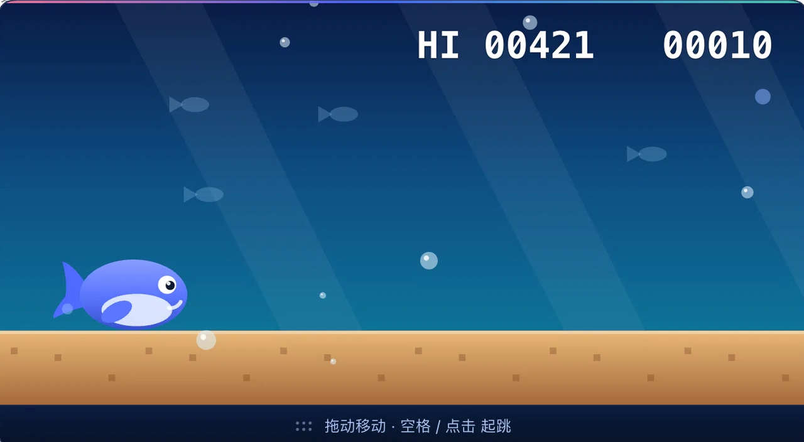

# dsh-whale-break

DeepSeek Harness 的"等待小鲸鱼"：对话执行时在页面顶部居中弹出一个 DeepSeek 小鲸鱼跑酷游戏，打发等待时间；回合结束或需要你处理时自动暂停隐藏，下一轮开始再出现。



## 功能

- **跟随回合状态**：`running` 时出现；回合结束、审批/提问等等待你处理时隐藏并暂停，不占用注意力。
- **DeepSeek 小鲸鱼**：彩色海底场景、渐变鲸身、摆动尾鳍、珊瑚障碍、小鱼与气泡视差。
- **操作**：单击画布或按空格起跳；输入法组字不拦截空格，`Shift+Space` 仍可正常输入空格。
- **位置**：默认顶部居中；拖动底部提示条可移动，双击提示条回到居中。
- **全网排行榜**：撞一次自动上榜，画布底部实时滚动显示 `#排名 名字 分数`；默认读写 `https://dsh.gson.cn/whale-break/scores`，所有玩家共享同一份榜单。
- **成绩**：右上角 `HI` 最高分，本地 `localStorage` 保存；服务器不可达时自动降级为本地。
- **总开关**：输入框左侧工具行的鲸鱼按钮，一键全局开关。

## 排行榜说明

- **全网榜**：`https://dsh.gson.cn/whale-break/scores`（服务实现与部署见 [server/README.md](server/README.md)）。
- **回退链**：自定义地址（`localStorage['dsh-rex-board']`）→ 全网榜 → 本机 Host 同源榜 `/dsh-whale-break/scores`；前一个不可达自动尝试下一个，全不可达时安静降级，不影响游戏。
- **本机同源榜**：由插件 Host 半侧提供（同一 Harness 下的另一个浏览器标签、手机经 dsh-app 共享），数据落在 `$DSH_HOME/plugin-data/dsh-whale-break/scores.json`。
- 榜单保留前 20 名；分数上限 9,999,999，名字最长 16 字符，每 IP 每分钟最多 20 次提交。
- **防刷分**：提交分数必须带服务端签发的一次性 run token（15 分钟有效、用后作废），且分数上限由服务端按这一局真实时长限制（约 22 分/秒），直接调接口写分会被拒绝。
- 名字在浏览器本地生成一次（`小鲸鱼####`），存在 `localStorage['dsh-rex-name']`。

## 安装

插件市场（推荐）：设置 → 插件 → 发现 → 「等待小鲸鱼」→ 安装。

命令行：

```bash
dsh plugin --profile web add dsh-whale-break
```

然后在 设置 → 插件 中启用本插件。

## 开发

```bash
npm test        # 纯逻辑自检：物理、碰撞、绘制调用
npm pack --dry-run
```

客户端代码在 `client.js`（无构建步骤，`window.__ModuleLoader__` 直接加载），宿主半侧 `index.js` 为空。

## 仓库

https://github.com/btboys/dsh-rex-game

## License

MIT
